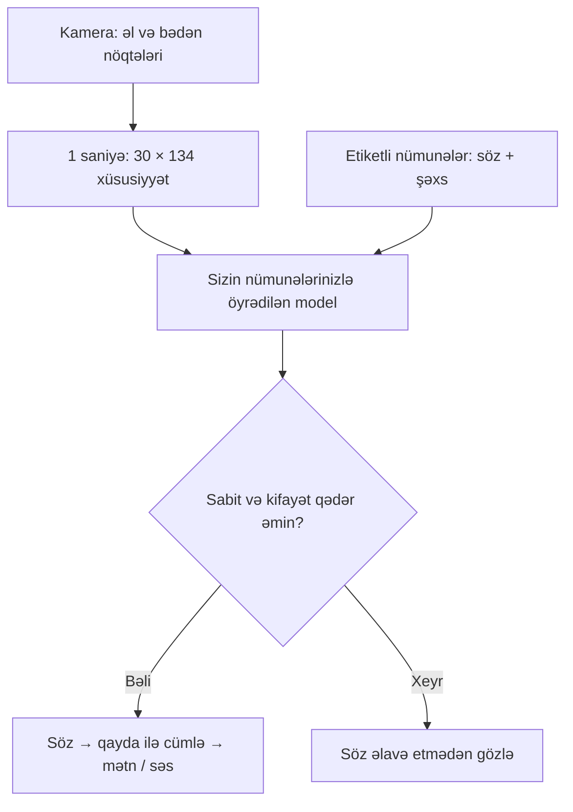

# Dilmanc — final mərhələsinə hazırlıq planı

19 oktyabr 2026 · təqdim edilmiş mənbə kodunun təhlili və yenilənmiş paket

## 1. Qərar

Final üçün 8–12 təsdiqlənmiş işarə ilə bir konkret ünsiyyət ssenarisini etibarlı göstərin. Başlanğıc ssenarisi artıq kodda var: poliklinikanın qeydiyyat masası. İndi böyük lüğət, avatar, mobil tətbiq və əlavə süni intellekt API-si açmaq əvəzinə data keyfiyyəti, yanlış tanımanın azalması, ikinci şəxsdə işləmə və ehtiyat kompüterə köçürülmə üzərində işləmək daha faydalıdır.

Bu paket tam işarə dili tərcüməçisi deyil. Məhdud lüğətdə ayrılmış işarələrin tanınması, qayda ilə cümlə qurulması və qarşı tərəfin yazı/danışıqla cavab verməsi prototipidir. Finala keçidə zəmanət vermək mümkün deyil; ölçülən nəticə və canlı işləyən ssenari iddianızı əsaslandırır.

## 2. Hazırda nə var, nə yoxdur?

| Hissə | Kodda vəziyyət | Praktik mənası |
|---|---|---|
| Kamera | MediaPipe əl və bədən nöqtələri | İki əlin 21 nöqtəsi; çiyin və burun koordinatları |
| Xüsusiyyətlər | Hər kadrda 134 rəqəm | Forma və bədənə görə yerləşmə birlikdə istifadə edilir |
| Tanıyıcı | TensorFlow.js Conv1D | 30 kadrı sizin nümunələrinizdən öyrənir |
| Lüğət | 8 standart söz + fon | Sözün adı var, amma onun necə işarə edildiyi kodda təsvir olunmur |
| Cümlə | Əvvəlcədən yazılmış qaydalar | `baş + ağrı` → `Başım ağrıyır.`; ümumi dil tərcüməsi deyil |
| Cavab | Brauzer danışıq tanıması; indi yazı və hazır cavab da var | Mikrofon işləməsə ünsiyyət davam edir |
| Dataset | IndexedDB | ZIP-də sizin topladığınız nümunələr yoxdur |
| Öyrədilmiş söz modeli | Brauzer IndexedDB-si | ZIP-də hazır söz klassifikatoru yoxdur |
| MediaPipe modelləri | Yenilənmiş paketdə `vendor/` içindədir | Bunlar sözləri bilmir; əl/bədən nöqtələrini tapır |
| Mimika və qrammatika | Tam üz izləmə və işarə dili qrammatikası yoxdur | Ümumi, sərbəst söhbət üçün ayrıca inkişaf lazımdır |

**Nəticə:** kodu başqa kompüterə köçürmək, öyrəndiyi sözləri köçürmək deyil. Dataseti və ya hazır model paketini ayrıca daşımaq lazımdır.

Model axını:

## 3. Bu paketdə düzəldilmiş problemlər

| Problem | Əvvəl | Düzəliş və sərhədi |
|---|---|---|
| FPS-dən asılı təlim | 30 kadr zəif kamerada 2–3 saniyə çəkə bilərdi | 1 saniyəlik pəncərə 30 kadra uyğunlaşdırılır. Köhnə aşağı FPS nümunələrinin müddəti geriyə dönük düzəldilmir |
| Ani yanlış söz | Tək yüksək orta ehtimalla söz qəbul edilirdi | Sabit qalma müddəti, minimum müşahidə, ilk iki nəticə arasındakı fərq yoxlanır. Naməlum bütün jestləri rədd etməyə zəmanət deyil |
| Eyni sözün təkrarı | Təsadüfi sıçrayışdan sonra təkrarlana bilərdi | Eyni sözü yenidən demək üçün neytral fasilə tələb olunur |
| Modelin daşınması | Yalnız TF çəkiləri ixrac edilirdi, idxal ekranı yox idi | Bir JSON-da çəkilər, sinif sırası, lüğət və nəticələr; idxal və səhifə yenilənəndə yükləmə |
| Zədələnmiş dataset | Ölçü/sinif/numeric yoxlaması yox idi | Düzgün ölçü, sonlu rəqəmlər, siniflər və təkrarlanan ID yoxlanır |
| Lüğət birləşməsi | Qaydalar idxal olunmurdu | Yeni qaydalar birləşdirilir; eyni ID fərqli söz deməkdirsə idxal rədd edilir |
| Şəxsə görə yoxlama | Bəzi siniflər yalnız testdə qala bilərdi | Bütün siniflərin həm öyrətmədə, həm yoxlamada olması tələb olunur |
| Nəticə şəffaflığı | Bir ümumi faiz | Qarışma matrisi və siniflər üzrə orta recall da var |
| Model göstəricisinin izahı | Yoxlama modeli ilə canlı model qarışa bilərdi | Ayrı şəxsdə ölçülmüş yoxlama modeli ilə sonra hamıdan öyrədilmiş canlı model fərqləndirilir |
| Mikrofon və internet | Cavab vermək mikrofonla məhdud idi | Yazılı cavab və üç hazır cavab əlavə edilib |
| Məxfilik mətni | Hər şeyin lokal olduğu deyilirdi | Kamera modelinin lokal, danışıq/səs xidmətlərinin isə internetdən istifadə edə biləcəyi göstərilir |
| Texniki dayanıqlıq | Label tensor sızması; ümumi açılış xətası görünmürdü | Tensor sərbəst buraxılır; açılış və bəzi yazma xətaları görünür |

## 4. “Hər hərəkəti bir-bir öyrətmədən hazır model ala bilərik?”

MediaPipe-in hazır əl detektoru artıq işinizi yüngülləşdirir: piksellərdən əl nöqtələrini özünüz öyrətmirsiniz. Amma bu nöqtələrin hansı Azərbaycan işarəsinə uyğun gəldiyi üçün etiketli nümunələr lazımdır. Google-un hazır Gesture Recognizer modeli bir neçə ümumi jesti tanıyır; Azərbaycan işarə dili lüğəti ilə təchiz edilmiş model deyil.

ASL və başqa dillər üçün datasetlər var, lakin onların sözlərini Azərbaycan işarə dilinin sözü kimi etiketləmək düzgün deyil. Onlar sonrakı mərhələdə hərəkət təqdimatının ilkin təlimi üçün araşdırıla bilər. Hazır videolardan landmark çıxarmaq, videoları işarə və şəxs üzrə etiketləmək, format/lisenziyanı yoxlamaq ayrıca işdir; mövcud 30×134 girişinə avtomatik uyğun gəlmir.

Bu gün ən sürətli yol: eyni lüğəti bir neçə kompüterdə yazın, datasetləri birləşdirin, modeli bir dəfə öyrədin və hazır modeli ixrac edin. Hər yeni istifadəçidə sıfırdan öyrətmək məqsəd deyil; bunu görülməmiş şəxsdə sınaqla yoxlamaq lazımdır.

## 5. Data toplama: konkret protokol

### Lüğəti əvvəl dondurun

Standart 8 söz: salam, həkim, ağrı, baş, dərman, təcili, harada, təşəkkür. Hər sözün real işarəsini yerli işarə dilini bilən şəxslə təsdiqləyin. Təsdiq alınmasa, təqdimatda “Azərbaycan işarə dilini tərcümə edir” əvəzinə “seçilmiş jestlərin tanınması prototipi” deyin.

Sözün etiketi, hərəkətin başlanğıcı/sonu, bir/iki əl tələbi və mənbə təsdiqi qısa qeyd olunsun. Sağ və sol əli sadəcə güzgüləyərək eyni etiket altında artırmayın: hər işarədə bunun mənanı saxladığı ayrıca yoxlanmalıdır.

### Tövsiyə olunan ilkin hədəf — nəticə vədi deyil

- 4 müxtəlif şəxs × 8 işarə × 15 nümunə = **480 işarə nümunəsi**.
- Hər şəxsdən 20 müxtəlif fon nümunəsi = **80 fon nümunəsi**.
- Cəmi **560 nümunə**. `Ardıcıl → 10 dəfə`, sonra `5 dəfə` ilə toplamaq olar.
- Hər şəxs hər sinfi yazsın. İmzalayan adına həmişə eyni yazılışı verin; `Qasim`, `qasim`, `Qasım` ayrı şəxslər sayılmasın.
- Az vaxt varsa 3 nəfərlə başlayın, amma 1 nəfərdən çox nümunə toplamaq müxtəlif insanlarla yoxlamanı əvəz etmir.

Bir hərəkəti sürətlə çoxaltmaq kifayət deyil. Nümunələr arasında əlləri başlanğıc vəziyyətinə qaytarın. Hərəkət pəncərənin içində tam yer alsın. Bir saniyəyə sığmayan işarəni süni sürətləndirməyin: həmin işarə üçün gələcəkdə dəyişən uzunluqlu seqmentləşdirmə lazımdır.

### Müxtəlifliyi məqsədli yaradın

Hər işarənin bir hissəsini adi sürətlə, bir hissəsini yavaş, bir hissəsini bir qədər fərqli məsafədə edin. İşığı və geyimi dəyişin, amma bir söz yalnız bir otaqda, başqa söz yalnız başqa otaqda yazılmasın. Bir neçə oturaq nümunə əlavə edin. Əllər kadrdan çıxmasın; kamera ilə bədən eyni görünüş istiqamətində qalsın.

Fon sinfində yalnız əllər aşağı olmasın: eynək/sac düzəltmək, su içmək, telefona baxmaq, oturmaq, başlanğıc/son keçidlər. Vizual olaraq işarələrə oxşayan adi hərəkətlər xüsusilə faydalıdır.

### Toplama axını

1. Hamı eyni lüğətlə başlayır. Ən yaxşısı əvvəl boş dataset/lüğət faylını paylaşmaqdır.
2. Hər kəs öz adı ilə nümunə yazır və `Dataseti yüklə` seçir.
3. Bir kompüterdə bütün datasetlər idxal edilir. Hər sinif və şəxs üzrə sayları yoxlayın.
4. Natamam və yanlış etiketli nümunələri silin; daha çox epox bu problemi həll etmir.
5. `Görülməmiş imzalayan` seçib modeli öyrədin. Qarışma matrisində ən çox qarışan cütlər üçün yeni, düzgün nümunələr toplayın.
6. Yoxlama nəticəsinə təkrar-təkrar baxıb ayar dəyişirsinizsə, həmin şəxs artıq yekun müstəqil test deyil. Son rəqəm üçün yeni şəxs və ya əvvəl istifadə olunmamış ayrıca sessiya saxlayın.
7. Hazır modeli ixrac edin. Ehtiyat kompüterdə idxal edib sıfırdan öyrətmədən açıldığını yoxlayın.

## 6. Finaldan əvvəl ölçüləcək nəticələr

Aşağıdakı rəqəmlər **təklif edilən qəbul hədəfləridir**, layihənin ölçülmüş nəticələri deyil. Hədəf alınmırsa real rəqəmi göstərin və demo lüğətini daraldın.

| Ölçü | Necə ölçməli | İlkin hədəf |
|---|---|---|
| Görülməmiş şəxsdə işarə tanıma | Təlimdə olmayan şəxsin hər işarəni 10 dəfə etməsi; 8 işarə üçün 80 sınaq | ≥85%; hər sinfin sayını ayrıca göstərin |
| Siniflər üzrə orta recall | Hər işarənin doğru sayını həmin işarənin sınaq sayına bölüb ortalayın | Zəif siniflərin ümumi faizdə gizlənməməsi |
| Yanlış aktivləşmə | 5 dəqiqə adi hərəkət, danışıq və istirahət; çıxan yanlış sözləri sayın | Dəqiqədə ≤1 yanlış söz; ideal 0 |
| Gecikmə | İşarə bitəndən ekranda qəbul olunan sözə qədər vaxt; 20 sınaq | Median <1,5 saniyə; p95 də qeyd edilsin |
| Cümlə ssenarisi | Eyni söhbət 10 dəfə, əllər arada normal vəziyyətə qayıdır | Ən azı 9 tam uğurlu axın |
| Daşınma | Təmiz brauzerdə hazır model idxalı və refresh | Nümunə yazmadan açılmalıdır |
| İnternetsiz kamera | Wi-Fi sönülü, səhifəni yenilə, işarə göstər | Lokal tanıma işləməlidir; mikrofon/səs ayrıca yoxlanır |

80 sınağın 72-si doğru çıxsa, `72/80 = 90%` deyin. Bu rəqəmi “Azərbaycan işarə dilində ümumi dəqiqlik” kimi təqdim etməyin. İştirakçı sayı, işarə sayı, sessiya və şərait yazılsın.

`tests/` qovluğundakı sintetik sınaqlar proqram məntiqini yoxlayır. Onların keçməsi bu cədvəldəki real sınaqları əvəz etmir.

## 7. Vaxta görə prioritetlər

### Finala 60 dəqiqədən az qalıbsa

Lüğəti böyütməyin. Dataseti dərhal ixrac edin. Ən yaxşı işləyən 4–8 təsdiqlənmiş işarəni sınayın. Yazılı cavabdan istifadə edin. Səhnə kompüterində interneti söndürüb kameranı yoxlayın. 45–60 saniyəlik ehtiyat video çəkin və onu canlı demo ilə qarışdırmayın. Bir dəfə təqdimatı vaxtla məşq edin.

### 2–4 saat varsa

Dörd nəfərlə toplama planını tətbiq edin, fon nümunələrinə vaxt ayırın, ayrı şəxsdə yoxlayın. Qarışan iki sinifdə data düzəlişi edin. Son modeli ixrac edin, ehtiyat kompüterdə sınayın. Bir əsas ssenari və iki ehtiyat cümlə ilə təqdimatı məşq edin.

### 1–2 gün varsa

Real istifadəçi və ya yerli işarə dili mütəxəssisi ilə qısa test edin, razılıqla rəy və nəticəni toplayın. İkinci gündə ayrıca sessiya ilə yoxlayın. Video datasetindən yarıavtomatik klip/landmark çıxarışı, keyfiyyət yoxlaması və çətin nümunə seçimi üçün alətlər əlavə edin. Əgər statik işarələr çoxdursa, kiçik kNN/DTW baza modeli ilə Conv1D-ni eyni bölgüdə müqayisə edin; hansının daha yaxşı olduğu real nəticədən seçilsin.

## 8. 3 dəqiqəlik təqdimat

| Vaxt | Nə göstərilir |
|---|---|
| 0:00–0:25 | Bir konkret çətinlik: qeydiyyat masasında tərcüməçi olmayan ünsiyyət. Ümumi statistika uydurmayın |
| 0:25–1:30 | Kamera ilə salam → baş → ağrı. Ekranda cümlə; səs sınanıbsa səsləndirin. Qarşı tərəf yazı və ya mikrofonla cavab verir |
| 1:30–2:05 | Model səhifəsi: neçə işarə, neçə şəxs, ayrı şəxsdə neçə doğru/nə qədər sınaq, qarışan sinif |
| 2:05–2:35 | İkinci şəxsin canlı sınağı və ya ehtiyat kompüterdə idxal edilmiş model. Təlimdə iştirak edib-etmədiyini dəqiq deyin |
| 2:35–3:00 | Növbəti mərhələ: yerli istifadəçilərlə təsdiqlənmiş dataset və bir müəssisədə sınaq; hələ razılaşdırılmayıbsa bunu plan kimi təqdim edin |

Avtomatik cümlə səsləndirmə yavaş işarələrdə cümləni tez bağlayırsa, demoda onu söndürüb cümlə tamamlananda `Səsləndir` düyməsinə basın. Sistemə göndərilməyən, tanınmayan hərəkətə görə cümləni təxmin edən əlavə dil modeli bu mərhələdə əsas problemi həll etmir.

## 9. Münsiflər üçün cavabın məzmunu

**“Yeniliyiniz nədir?”** Yerli işarələr üçün təsdiqlənən kiçik lüğət, brauzerdə fərdiləşdirilə bilən model və konkret xidmət nöqtəsində iki tərəfli ünsiyyət axını. MediaPipe-i öz modeliniz kimi təqdim etməyin: sizin hissəniz data axını, temporal tanıyıcı, qaydalar və məhsul ssenarisidir. “Dünyada ilk” iddiası üçün araşdırılmış sübut yoxdur.

**“Hamının əlində işləyirmi?”** Yalnız ölçdüyünüz nəticəni, şəxs və sınaq sayını deyin. Bir şəxsdə yaxşı işləməsi hamıya ümumiləşmə sübutu deyil.

**“Məxfilik necədir?”** Kamera üçün landmark çıxarma və işarə tanıma lokaldır. Kamera videosu lokaldır. Səsləndirilən yeni cümlənin mətni Azure-a göndərilir; audio lokal saxlanır. Mikrofon brauzerin xidmətindən istifadə edir; yazılı cavab oflayn ehtiyatdır.

**“Məhsula necə çevriləcək?”** İlk hədəf olaraq xidmət nöqtəsində bir sınaq təklif edin. Abunəlik qiyməti, bazar ölçüsü və qənaət hələ ölçülməyibsə bunları təsdiqlənmiş göstərici kimi göstərməyin. İlk ölçülər: uğurla tamamlanan dialoq, istifadəçinin düzəliş sayı, cavaba qədər vaxt və yenidən istifadə istəyi.

## 10. Finaldan sonra inkişaf sırası

1. Real istifadəçilərlə söz və hərəkət təsdiqi, istifadəçi razılığı və versiyalanmış dataset.
2. Dəyişən müddətli işarələrin başlanğıc/son seqmentləşdirilməsi; fasiləsiz tanıma.
3. Üz/mimika və daha zəngin bədən xüsusiyyətləri; bu dəyişiklik giriş formatını və əvvəlki modelləri dəyişəcək.
4. Fərqli cihazlar, işıq və insanlarla ayrıca sessiya/şəxs üzrə yoxlama; ehtimal kalibrasiyası və naməlum işarələr üçün rədd mexanizmi.
5. Yalnız tanıma sabitləşəndən sonra daha geniş lüğət, əlavə dillər, avatar və müəssisə inteqrasiyası.

## 11. Texniki mənbələr

- Google MediaPipe Gesture Recognizer: hazır jest sinifləri və öz datasetinizlə fərdiləşdirmə — https://developers.google.com/edge/mediapipe/solutions/vision/gesture_recognizer
- Google MediaPipe Hand Landmarker Web: video axını və sinxron inferensiya — https://developers.google.com/edge/mediapipe/solutions/vision/hand_landmarker/web_js
- TensorFlow.js modelin saxlanması/yüklənməsi və xüsusi IO handler — https://www.tensorflow.org/js/guide/save_load
- Web Speech Recognition: brauzerdən asılı server emalı və oflayn məhdudiyyəti — https://developer.mozilla.org/en-US/docs/Web/API/SpeechRecognition
- Microsoft Research ASL Citizen: ASL üçün ayrıca işarə dataseti, istifadə şərtləri ayrıca yoxlanmalıdır — https://www.microsoft.com/en-us/research/project/asl-citizen/

Bu sənəddə fakt kimi təqdim edilmiş layihə nəticələri yalnız kodda müşahidə edilən davranışlardır. Real istifadəçi dəqiqliyi, gecikmə və final uğuru ölçülməyib.

## 12. Paket üzrə görülmüş yoxlamalar

- 13 avtomatik test keçdi: fərqli FPS-lərin eyni zaman pəncərəsinə gətirilməsi, kamera donması, sabit tanıma və neytral fasilə, dataset yoxlaması, modelin tam ixrac–idxalı, tensor sızması və sintetik data ilə həqiqi təlim epoxu.
- JSDOM + fake-indexeddb ilə interfeys inteqrasiyası keçdi: 4 bölmə, yazılı/hazır cavab, 20 sintetik nümunə idxalı, ayrı şəxs bölgüsü ilə təlim, qarışma matrisi, modelin ixrac–idxalı, IndexedDB-dən yenidən yüklənməsi və səhv datasetdə məlumatın qorunması.
- JS sintaksisi, lokal import yolları, HTML ID-ləri və diff formatı yoxlanıb. Lokal runtime faylları daxil edilib və SHA-256 siyahısı yaradılıb.
- Real Chromium-u bu mühitdə yükləmək mümkün olmadı. Ekran yerləşməsi, real kamera/MediaPipe inferensiyası, mikrofon, Azərbaycan səsi və canlı işarələrin dəqiqliyi bu mühitdə təsdiqlənməyib. Onları səhnə kompüterində yoxlayın.

## 13. Azure Azərbaycan səsi — son yeniləmə

Banu və Babek Azərbaycan səsləri üçün lokal `server.py` və Azure REST bağlantısı əlavə edilib. Browser səsindən və türk dili ehtiyatından istifadə edilmir. Region və KEY hələ real hesabla qurulmayıb; yeni cümlənin audio faylı üçün Azure-a mətn göndərilir. Əvvəl hazırlanmış eyni mətn və eyni səs lokal diskdən oxunur. Ətraflı: `AZURE_QURULMA_AZ.md`.

17 JavaScript testi, 8 Python server testi və Azure səs seçimi/hazırlanması/xəta mesajları üçün interfeys inteqrasiya sınağı keçib; sınaq nəticəsi canlı Azure keyfiyyətini əvəz etmir. Azure üçün həqiqi açarla canlı səs yoxlaması ayrıca edilməlidir.

Hazır Azərbaycan datası da var: AzSLD `Words_100` (1,1 GB) və `Words_200` (1,4 GB), https://zenodo.org/records/14222948. Bütün nümunələri sıfırdan çəkmək məcburi deyil. Hazır videoların Dilmanc formatına çevrilməsi ayrıca mərhələdir; bu Azure yeniləməsinə video dataset importer daxil deyil.
