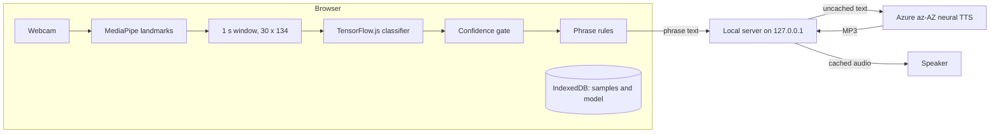

<p align="center">
  <picture>
    <source media="(prefers-color-scheme: dark)" srcset="assets/readme/hero-dark.gif">
    
  </picture>
</p>

<p align="center">
  <b>Sign recognition for clinic reception in Azerbaijan, running in the browser.</b><br>
  Elvo recognizes a recorded vocabulary of signs through a webcam, builds a predefined Azerbaijani sentence, and speaks it aloud. The receptionist answers on screen.
</p>

<p align="center">
  
  
  
  
  
  
</p>

<p align="center">
  <a href="#how-it-works">How it works</a> ·
  <a href="#quick-start">Quick start</a> ·
  <a href="#train-your-own-signs">Train your own signs</a> ·
  <a href="#privacy-and-connectivity">Privacy</a> ·
  <a href="#limitations">Limitations</a> ·
  <a href="#team">Team</a>
</p>

> [!IMPORTANT]
> Elvo is a limited-vocabulary research prototype. It is not a general sign language translator, a medical device, or a replacement for a qualified interpreter. Validate every sign with fluent Azerbaijani Sign Language users before collecting training data.

<!-- Pitch video: upload elvo-pitch.mp4 through the GitHub web editor and paste the generated link on its own line here. -->

## Why Elvo

A Deaf patient walks up to a clinic reception. The receptionist does not sign, and an interpreter is not always available. Elvo covers the first, most common exchanges at that desk: a greeting, a request for a doctor, where to go, how urgent it is.

<p align="center">
  <picture>
    <source media="(prefers-color-scheme: dark)" srcset="assets/readme/solution-dark.gif">
    
  </picture>
</p>

<table>
  <tr>
    <td width="33%" valign="top"><b>Sign</b><br>A webcam and MediaPipe landmarks. Recognition and training run in the browser, with no special hardware.</td>
    <td width="33%" valign="top"><b>Phrase</b><br>Recognized signs map to predefined clinic phrases. Short sequences combine into full sentences.</td>
    <td width="33%" valign="top"><b>Voice</b><br>Azure Azerbaijani neural voices, Banu or Babek, speak the phrase. The receptionist replies by voice, typing, or one tap.</td>
  </tr>
</table>

## Highlights

<table>
  <tr>
    <td width="50%" valign="top"><b>Live recognition</b><br>Webcam sign recognition with hand landmark overlays, confidence scores, and a gate that waits for a stable, confident winner.</td>
    <td width="50%" valign="top"><b>Your vocabulary</b><br>Add signs and phrase rules in the app. Record samples, train, and evaluate without leaving the browser.</td>
  </tr>
  <tr>
    <td width="50%" valign="top"><b>Honest evaluation</b><br>Random per-class split or held-out signer evaluation, confusion matrix, and balanced recall. The final model then trains on all samples.</td>
    <td width="50%" valign="top"><b>Two-way conversation</b><br>Azerbaijani speech recognition where the browser supports it, typed replies, and quick replies shown large for the patient.</td>
  </tr>
  <tr>
    <td width="50%" valign="top"><b>Team-friendly data</b><br>Validated dataset export and import that merge recordings across computers by sample ID, plus portable model bundles.</td>
    <td width="50%" valign="top"><b>Ready for a stage</b><br>Azerbaijani and English interface, projector mode, keyboard shortcuts, cached demo phrases, and optional local copies of the libraries and landmark models.</td>
  </tr>
</table>

## How it works

<p align="center">
  <picture>
    <source media="(prefers-color-scheme: dark)" srcset="assets/readme/pipeline-dark.gif">
    
  </picture>
</p>

1. **Landmarks.** MediaPipe Tasks Vision tracks up to two hands every frame and the upper body every third frame.
2. **Time window.** Each frame becomes 134 features: the nose relative to the shoulders, then a slot for each hand with presence, wrist position, and 21 wrist-relative 3D points. One second of frames is resampled by timestamp to 30 frames, so capture does not depend on camera FPS. Windows with tracking gaps over 250 ms are rejected.
3. **Classifier.** A small temporal convolutional network in TensorFlow.js scores every sign plus a background class.
4. **Gate.** A sign counts only when it clears the confidence threshold (80% by default), leads the runner-up by a margin, and stays on top long enough. Evaluation continues for 600 ms after the hands drop, so a final sign is not lost.
5. **Phrase.** The longest matching predefined rule turns signs into a sentence. Otherwise each sign speaks its own phrase.
6. **Voice.** The local Python server sends the text to Azure, caches the MP3 on disk, and plays it back. The phrase is prepared during the pause before it is spoken.



<details>
<summary><b>Model and training details</b></summary>

<br>

| Part | Setting |
| --- | --- |
| Input | 30 frames x 134 features (one second) |
| Layers | Conv1D 64 (kernel 5), dropout 0.15, Conv1D 96 (kernel 3), max pooling, Conv1D 128 (kernel 3), global average pooling, dropout 0.3, softmax |
| Optimizer | Adam, learning rate 0.001, categorical cross-entropy |
| Training | 20, 35 (default), or 60 epochs, batch size 32 |
| Augmentation | Temporal crops, position and scale variation, shape jitter, random mirroring. Training data only. |
| Evaluation | Random stratified split or held-out signer, then a final model trained on all samples |

Mirroring swaps the hand slots and flips horizontal coordinates. It improves robustness; it is not evidence of accuracy for left-handed signers. Training time depends on the device and dataset.

</details>

## Sentences from sign sequences

<p align="center">
  <picture>
    <source media="(prefers-color-scheme: dark)" srcset="assets/readme/phrases-dark.gif">
    
  </picture>
</p>

The default vocabulary covers `salam`, `həkim`, `ağrı`, `baş`, `dərman`, `təcili`, `harada`, and `təşəkkür`, plus a background class for ordinary movement. Rules combine them, and the longest match wins:

| Signs | Spoken phrase | Meaning |
| --- | --- | --- |
| `baş` + `ağrı` | Başım ağrıyır. | My head hurts. |
| `baş` + `ağrı` + `dərman` | Başım ağrıyır, dərman lazımdır. | My head hurts, I need medicine. |
| `təcili` + `həkim` | Təcili həkim lazımdır! | I need a doctor urgently! |
| `həkim` + `harada` | Həkim haradadır? | Where is the doctor? |
| `dərman` + `harada` | Dərmanı haradan ala bilərəm? | Where can I get medicine? |
| `ağrı` + `təcili` | Çox ağrıyır, təcilidir! | It hurts a lot, it is urgent! |

Signs, phrases, and rules are editable in **Vocabulary & settings**.

## Train your own signs

<p align="center">
  <picture>
    <source media="(prefers-color-scheme: dark)" srcset="assets/readme/training-dark.gif">
    
  </picture>
</p>

1. Validate the vocabulary with fluent signers.
2. In **Record samples**, choose a sign, enter the real signer's name, and record one-second samples. Samples without enough visible hands are rejected.
3. Record **Background** samples too: hands out of view, resting hands, ordinary gestures, touching the face, handling objects.
4. Collect each sign from several people, with varied clothing, lighting, and camera distance.
5. In **Model**, choose random split or held-out signer evaluation, then train.
6. In **Live translation**, test recognition, phrases, and speech.

Aim for at least 20 samples per class from at least three signers as a starting point, not a guarantee of accuracy. To combine recordings, export each dataset and import them on one computer; a sample with an existing ID replaces the stored one, so corrected signer labels do not create duplicates.

> [!TIP]
> When you report a result, include the number of test samples, class coverage, and the evaluation method. A random split can look better than real use because the same people and conditions appear in both sets. A held-out signer result is meaningful only when signer labels are correct.

## Quick start

You need Python 3.10 or newer, a current Chrome or Edge, a webcam, and an Azure Speech resource for voice output.

```sh
git clone https://github.com/hajizadaravan/elvo.git
cd elvo
sh scripts/vendor.sh            # download TensorFlow.js, MediaPipe, and landmark models into vendor/
python3 server.py --configure   # first run: enter the Azure region and key
```

Open <http://localhost:8000> and allow camera access. Later, start the app with `python3 server.py`.

The server uses only the Python standard library. The key is entered hidden and saved to the ignored `.env` file; it never reaches the browser. Camera access needs `localhost` or HTTPS, so opening `index.html` directly does not work, and a plain static server has no speech endpoints.

<details>
<summary><b>Azure speech setup</b></summary>

<br>

1. In the Azure portal, open or create a Speech resource. Copy `KEY 1` and the short region code, such as `westeurope`, from **Keys and Endpoint**. The region is not the endpoint URL.
2. Run `python3 server.py --configure` (`py server.py --configure` on Windows) and enter both values.
3. In **Vocabulary & settings**, choose Banu (`az-AZ-BanuNeural`) or Babek (`az-AZ-BabekNeural`) and press **Test**. Only Test confirms that the key works.
4. Before a demo, press **Prepare demo voices** while online. Vocabulary phrases, rules, and demo phrases are cached for the selected voice in `.dilmanc-cache/tts/`.

Speech runs 10% faster than the default rate, with short pauses between sentences. Azure usage may be billed according to your subscription.

| Message | What to do |
| --- | --- |
| Speech server unavailable | Stop the static server and run `python3 server.py` |
| Azure not configured | Run `python3 server.py --configure` |
| Check the Azure key, region, and access | Use the key and region from the same Speech resource, then reconfigure |
| Request limit reached | Check the Azure quota and try again later |
| Could not connect to Azure | Check the connection; only cached text can play |
| Browser blocked audio | Press **Speak** or **Test**, then check the site's audio permission |

</details>

<details>
<summary><b>Offline use</b></summary>

<br>

After `sh scripts/vendor.sh`, recording, training, and recognition run without fetching dependencies from a CDN. Google Fonts falls back to system fonts. Azure needs a connection for new text, but cached phrases replay offline while the local server runs. Browser speech recognition may use the browser provider's online service. Test the exact presentation setup before relying on it offline.

</details>

<details>
<summary><b>Keyboard shortcuts</b></summary>

<br>

| Key | Action |
| --- | --- |
| <kbd>Space</kbd> | Start or stop recording in **Record samples** |
| <kbd>Enter</kbd> | Speak the pending phrase in **Live translation** |
| <kbd>Backspace</kbd> | Remove the last pending sign |
| <kbd>Esc</kbd> | Leave projector mode |

</details>

## Privacy and connectivity

- Video stays on the device. Landmark processing and training run in the browser, and samples and the model are stored in browser storage, not on an application server.
- New phrase text goes from the local server to Azure for speech. Cached audio stays in `.dilmanc-cache/`.
- Browser speech recognition may process microphone audio on the browser provider's servers.
- The server listens on `127.0.0.1` only and does not serve `.env`, `.git`, or the audio cache.
- Get participants' consent before collecting or sharing datasets, and export backups before clearing browser storage.

## Limitations

- Recognition covers only the recorded vocabulary and training conditions.
- Facial grammar, unrestricted continuous signing, and fingerspelling are not implemented.
- Rule-based phrases are not a general sign language grammar model.
- High confidence scores and mirroring augmentation do not establish real-world accuracy.
- Signing conventions need validation with the intended Azerbaijani users.
- Do not use Elvo for clinical decisions or as a replacement for a qualified interpreter.

## Working with Deaf signers

Sign language technology works only when the people who sign shape it. These principles guide how Elvo is built and used:

- **Signers choose the vocabulary.** Signs and phrases are chosen and checked with fluent Azerbaijani Sign Language users, ideally Deaf signers, before any recording.
- **Consent comes first.** Record only people who agreed to it, label samples with the real signer, and share datasets only with that consent.
- **Support, not substitution.** Elvo is for short, predictable exchanges. Interpreters and the patient's own choice of communication come first.

The [Sign Language Processing survey](https://research.sign.mt) by Moryossef and Goldberg describes these practices in more depth. If you are a Deaf signer, an interpreter, or a clinic in Azerbaijan and would like to help test Elvo, we would like to hear from you.

## Built with

| Layer | Technology |
| --- | --- |
| Landmarks | MediaPipe Tasks Vision 0.10.14, Hand Landmarker and Pose Landmarker Lite |
| Model | TensorFlow.js 4.22, trained and run in the browser |
| Speech output | Azure AI Speech, Azerbaijani neural voices Banu and Babek |
| Speech input | Web Speech API, `az-AZ` |
| Storage | IndexedDB and localStorage |
| Server | Python 3.10+ standard library, localhost only |
| Interface | Plain HTML, CSS, and ES modules, no build step |

## Team

Elvo is built by **Project-ZH**.

| Name | Role |
| --- | --- |
| Gasim Garayev | Product designer |
| [Ravan Hajizada](https://github.com/hajizadaravan) | System design and development |
| Rahman Pashayev | QA testing |

## Contributing

Conventions, the file map, data contracts, and verification commands are in [AGENTS.md](AGENTS.md). Interface rules are in [DESIGN.md](DESIGN.md). Elvo was previously called Dilmanc; storage keys and file format IDs keep the `dilmanc` prefix so existing data still loads.

<br>
<p align="center"><sub>Made by Project-ZH</sub></p>
